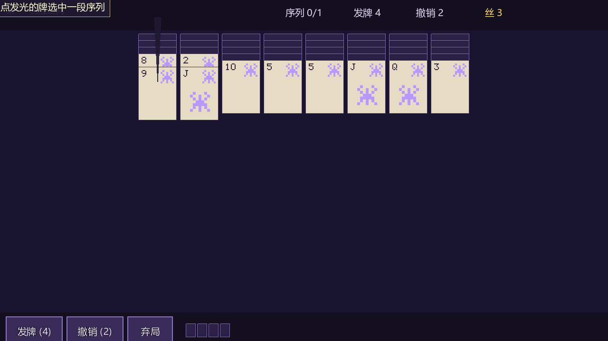

# 织网者：诅咒之塔（WEAVER — Demo）

蜘蛛纸牌 × 肉鸽构筑。Godot 4 实现的单场景垂直切片：一局牌桌、一条塔层时间线、一套遗物与印记经济。

纯逻辑引擎与渲染分离，无外部依赖、无音频素材，克隆即可运行。



## 运行

1. 安装 [Godot 4.7](https://godotengine.org/download)（标准版，无需 .NET）。
2. 导入本目录的 `project.godot`，按 F5。

窗口 1280×720，内部逻辑分辨率 640×360，整数倍缩放的像素渲染。

## 操作

- 左键点一张牌：选中从它开始的同花降序序列（白色描边）。
- 左键点目标列：落下，可落点显示淡色描边。
- 右键取消选择。
- 底部按钮：发牌 / 撤销 / 弃局（连按两次确认）。

## 规则速查

- 经典蜘蛛纸牌：同花降序序列整体移动，K→A 完整同花序列自动消除。
- 过关 = 消除够目标组数；发牌耗尽且无路可走即失败，整局重来。
- 花色：紫=蜘蛛，红=飞蛾，蓝=甲虫，绿=蜈蚣。塔层越高花色越多。
- 局间商店买遗物（15 种）与印记（落在具体牌上、跨遭遇持久）。

## 项目结构

```
scenes/main.tscn        唯一场景
scripts/pixel.gd        像素字体 / 花色图标 / 配色（程序化绘制，零素材）
scripts/card.gd          牌数据
scripts/engine.gd        蜘蛛纸牌纯逻辑引擎（撤销快照 / 死局检测 / 遗物钩子）
scripts/run_state.gd     Run 状态与持久牌组（印记优先保留的重铸）
scripts/relics.gd        遗物表（15）
scripts/marks.gd         印记表（5+1）
scripts/events.gd        事件池（6）
scripts/encounters.gd    时间线（3 巢 16 节点）
scripts/ui.gd            UI 工厂（中文字体回退）
scripts/table_view.gd    牌桌渲染与交互
scripts/shop_screen.gd / event_screen.gd / main.gd
assets/raw/gen.sh        卡面素材的生成脚本（读取环境变量 GPT_IMAGE_KEY）
```

## 验证

本机 Godot 4.7.2 已通过：

- `tests/test_headless.gd` — 无头逻辑自测（牌组构建 / 引擎初始化 / 移动撤销 / 发牌 / 空列限制 / 印记持久化）
- `tests/test_smoke.gd` — 带渲染整机冒烟（16 节点全流程）
- `tests/test_screenshot.gd` — 自动截图至 `tests/shots/`

```bash
# 首次运行需先导入一次，生成脚本类缓存
godot --headless --import
godot --headless -s tests/test_headless.gd
godot -s tests/test_smoke.gd
```

## 调参入口

- 遭遇难度（列数 / 发牌 / 目标 / 花色）：`scripts/encounters.gd`
- 遗物数值与售价：`scripts/relics.gd`
- 印记数值：`scripts/marks.gd`
- 经济（丝收入）、基础撤销次数：`scripts/main.gd`

## 已知限制

- Demo 范围：无音频、无存档、无局外成长。
- 中文依赖系统字体回退（已显式指定字体链）。
- 卡面素材由脚本调用图像模型生成，仓库内为成品 PNG，不含任何密钥。

## 许可证

源码公开用于作品展示与交流。未附带开源许可证，版权归作者所有，未经许可请勿商用或再分发。
